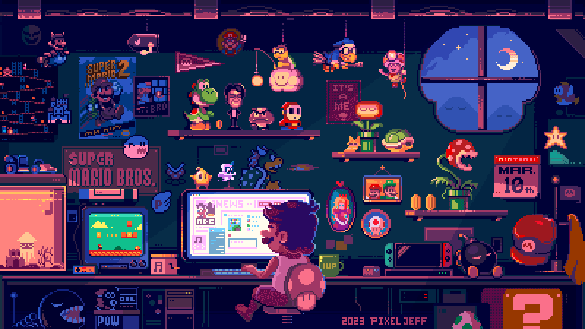

  

  <h1>Ilyas ABDELLAOUI</h1>
  
<b>Platform Engineer</b> • Kubernetes & Cloud Infrastructure

  

    
    
    
  

---

### 👨‍💻 About Me

I’m Ilyas, a **Platform Engineer** working mostly with Kubernetes and cloud infrastructure. I build tools and platforms to help developers get stuff done without headaches. Just enjoying the ride and learning as I go.

  <a href="https://certdirectory.io/profile/ilyas-abdellaoui?utm_source=github&utm_medium=readme">
    <picture>
      <source media="(prefers-color-scheme: dark)" srcset="https://certdirectory.io/badge/ilyas-abdellaoui.svg?style=card&theme=dark">
      
    </picture>
  </a>

---

### 🛠️ Skills

  
<b>Cloud & DevOps</b>

  

  
<b>Backend</b>

  

  
<b>Frontend</b>

  

  
<b>Databases & Tools</b>

  

---

### 📊 GitHub Stats

  
  
   
  

---

### 🏆 Trophies

  

---

  
💬 Feel free to reach out on <a href="https://twitter.com/ilyas_abdell">Twitter</a> or <a href="https://www.linkedin.com/in/ilyas-abdellaoui/">LinkedIn</a> for any inquiries or just to chat!

